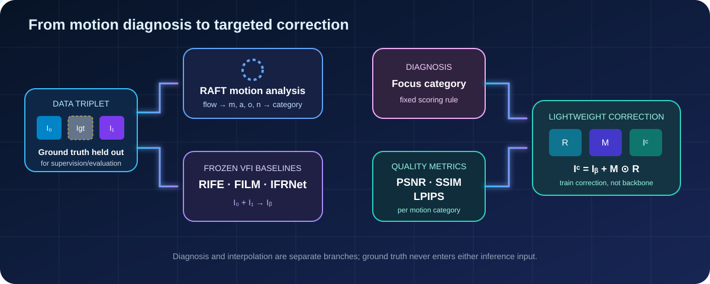
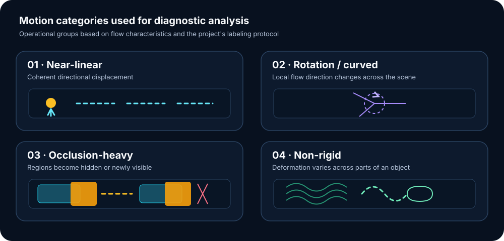
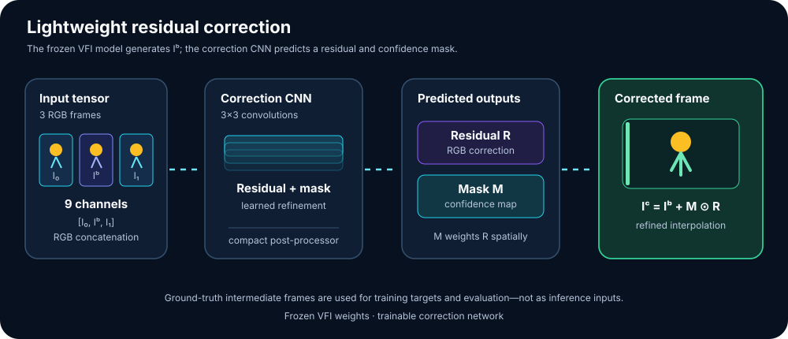
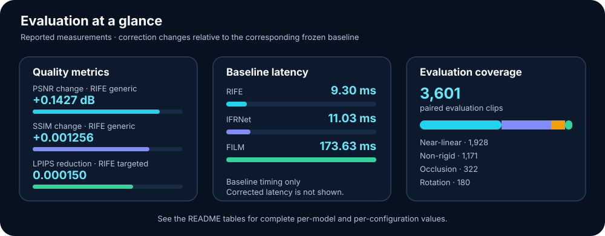

<div align="center">



# Motion-Type-Aware Video Frame Interpolation

### Motion-aware analysis and lightweight correction for modern video frame interpolation.

<p>
  
  
  
  
  
</p>

**A diagnosis-to-correction study — not a new VFI backbone.**

[Pipeline](#-the-big-picture) · [Method](#-how-the-method-works) · [Results](#-reported-results) · [Repository guide](#-repository-map) · [Reproduction](#-reproducing-the-workflow)

</div>

---

## The question behind the project

Video frame interpolation is challenging because different motion patterns create different reconstruction demands. This project studies model behaviour across distinct motion categories and explores lightweight correction strategies alongside established pretrained models.

**The project is organized around two complementary objectives:**

1. **Motion-aware diagnosis:** How do established VFI models perform across distinct motion categories when evaluated with PSNR, SSIM, and LPIPS?
2. **Lightweight correction:** How can a residual correction network refine interpolated frames, and how do generic and motion-targeted training strategies compare?

We evaluate pretrained **RIFE, FILM, and IFRNet** as frozen baselines, characterize motion with **RAFT-derived optical-flow descriptors**, and compare generic correction with rotation-targeted correction.

> **Scope:** the VFI backbones remain frozen. The learned component is a separate, lightweight residual correction network.

## ✨ The big picture



The two branches answer different questions:

- **RAFT branch:** *What motion characteristics are present?*
- **VFI branch:** *What intermediate frame does the model predict?*

The motion label and interpolation metrics are combined to guide category-aware analysis and correction experiments.

## 🧭 How the method works



### 1. Build a valid interpolation triplet

Each sample contains three temporally consecutive frames:

| Symbol | Meaning | Used as a model input? |
|---|---|---|
| `I₀` | First observed frame | Yes |
| `Igt` | Ground-truth middle frame | **No** — supervision/evaluation only |
| `I₁` | Last observed frame | Yes |
| `Iᵦ` | Baseline model's generated middle frame | Produced by VFI |
| `Iᶜ` | Corrected middle frame | Produced by the correction network |

The baseline receives **`I₀` and `I₁`**, not `Igt`. The ground-truth frame is held out so the generated frame can be evaluated fairly.

### 2. Characterize motion with RAFT

RAFT is used as a **frozen optical-flow estimator for motion characterization**, not as a VFI baseline and not as an input to the correction CNN. Its flow field is summarized into four descriptors:

| Descriptor | Intuition | Main diagnostic role |
|---|---|---|
| `m` — motion magnitude | How far pixels move | Motion magnitude / comparatively simple motion |
| `a` — angular variance | How much local flow direction varies | Rotation or curved motion |
| `o` — occlusion ratio | How much flow fails forward–backward consistency | Occlusion-heavy scenes |
| `n` — non-rigidity score | How spatially inconsistent local flow deformation is | Non-rigid motion |

The descriptors are standardized and compared with calibrated thresholds to assign one dominant category: **near-linear, rotation/curved, occlusion-heavy, or non-rigid**. These are operational, descriptor-derived categories—not perfect semantic ground-truth labels.

### 3. Evaluate frozen VFI baselines

RIFE, FILM, and IFRNet each generate `Iᵦ` from the two observed frames. Their weights are not updated during baseline diagnosis.

We report:

- **PSNR** — pixel-level reconstruction fidelity; higher is better.
- **SSIM** — structural similarity; higher is better.
- **LPIPS** — learned perceptual distance; lower is better.

Results are grouped by motion category rather than being reduced to one overall score alone.

### 4. Identify a category for focused analysis

Category-level metric values are normalized and combined using the study's diagnostic scoring rule. This provides a consistent basis for comparing motion categories and selecting a focus for targeted correction.

### 5. Apply lightweight residual correction



The correction network receives the concatenation **`[I₀, I₁, Iᵦ]`**:

- RGB `I₀`: 3 channels
- RGB `I₁`: 3 channels
- RGB `Iᵦ`: 3 channels
- **Total: 9 channels**

It predicts:
- `R`: a three-channel residual image
- `M`: a one-channel learned confidence mask, constrained with a sigmoid

The corrected image is:

\[
I_c = I_b + M \odot R
\]

`M` is a learned, continuous per-pixel weighting map. It is **not** a semantic segmentation mask. During training, `Igt` provides supervision; at inference time, the network receives only `I₀`, `I₁`, and `Iᵦ`.

## 🧪 Experimental comparison

The experimental design compares a frozen baseline, a generic correction network, and a correction network trained for a selected motion category.

| Condition | What it tests |
|---|---|
| **A — Frozen baseline** | Original VFI output, with no correction |
| **B — Generic correction** | Same correction architecture trained across all motion categories |
| **C — Rotation-targeted correction** | Correction trained on the rotation category selected by the study's current protocol |

Comparing **B and C** helps characterize how the correction-training strategy influences the measured output quality.

## 📊 Reported results

The tables summarize the measurements recorded in the current project results.

### Dataset composition



| Motion category | Clips | Share |
|---|---:|---:|
| Near-linear | 1,928 | 53.5% |
| Non-rigid | 1,171 | 32.5% |
| Occlusion | 322 | 8.9% |
| Rotation | 180 | 5.0% |
| **Total** | **3,601** | **100%** |

### Mean change from the frozen baseline

Changes are measured relative to the corresponding frozen baseline; PSNR and SSIM are higher-is-better metrics, while LPIPS is lower-is-better.

| Model | Correction | Δ PSNR (dB) | Δ SSIM | LPIPS reduction |
|---|---|---:|---:|---:|
| RIFE | Generic | **+0.1427** | **+0.001256** | 0.000045 |
| RIFE | Rotation-targeted | +0.0322 | +0.000227 | 0.000150 |
| FILM | Generic | +0.0099 | +0.000063 | 0.000070 |
| FILM | Rotation-targeted | +0.0070 | +0.000054 | **0.000108** |
| IFRNet | Generic | +0.0204 | +0.000298 | **0.000122** |
| IFRNet | Rotation-targeted | −0.0003 | +0.000013 | 0.000062 |

### Frozen-baseline inference time

| Model | Mean latency | FPS |
|---|---:|---:|
| RIFE | **9.30 ms** | **107.5** |
| IFRNet | 11.03 ms | 90.7 |
| FILM | 173.63 ms | 5.8 |

*Latency depends on hardware, resolution, precision, and inference settings. Consult the notebook outputs for the experiment context.*

### Key observations

- **RIFE with generic correction** records the largest average PSNR and SSIM gains among the configurations listed.
- **FILM** has a higher reported inference latency than RIFE and IFRNet in the timing comparison.
- Comparing generic and rotation-targeted configurations provides a view of how correction-training strategy affects each model.

The results illustrate that correction behaviour varies across the tested baseline models and training configurations, reinforcing the value of reporting model-specific measurements.

## 🗂️ Repository map

| Path | Purpose |
|---|---|
| [`VFI.pdf`](VFI.pdf) | Project paper: methodology, equations, experimental protocol, discussion |
| [`notebooks/raft-vfi.ipynb`](notebooks/raft-vfi.ipynb) | RAFT descriptors, calibration, category classification, diagnostic scoring |
| [`notebooks/rife-bp-cnn.ipynb`](notebooks/rife-bp-cnn.ipynb) | Frozen RIFE baseline and correction experiments |
| [`notebooks/film-vfi-3-10-env.ipynb`](notebooks/film-vfi-3-10-env.ipynb) | Frozen FILM baseline and correction experiments |
| [`notebooks/ifrnet-vfi.ipynb`](notebooks/ifrnet-vfi.ipynb) | Frozen IFRNet baseline and residual correction |
| [`notebooks/ifrnet-vfi-before-residual-alignment.ipynb`](notebooks/ifrnet-vfi-before-residual-alignment.ipynb) | Preserved pre-alignment snapshot for provenance |
| [`notebooks/comp_results/`](notebooks/comp_results/) | Per-clip metric CSVs and summary outputs |
| [`notebooks/comp_results/model_improvement_summary.md`](notebooks/comp_results/model_improvement_summary.md) | Paired-result summary and confidence intervals, if present in the repository |

> Notebook outputs and exploratory cells are retained for auditability. Follow the RAFT notebook's marked **final 170-clip calibration** reading guide. The current IFRNet correction architecture is aligned with RIFE/FILM; rerunning it requires checkpoints trained for that architecture.

## ♻️ Reproducing the workflow

The reported notebooks were run in **Kaggle with GPU acceleration**. Paths and data/checkpoint locations are configured for that environment.

1. **Attach inputs.** Add the required Vimeo-90K triplets, pretrained VFI checkpoints, RAFT source/checkpoint, split manifest, and saved descriptor/metric CSVs as Kaggle inputs.
2. **Run RAFT diagnosis.** Open [`notebooks/raft-vfi.ipynb`](notebooks/raft-vfi.ipynb) and follow the documented final calibration path.
3. **Run a baseline notebook.** Choose RIFE, FILM, or IFRNet. Keep the VFI backbone frozen; train only the correction CNN.
4. **Evaluate on the fixed test set.** Use the same 3,601 paired clips and report PSNR, SSIM, and LPIPS.
5. **Preserve provenance.** Record checkpoint identity, input resolution, precision, hardware, package versions, split manifest, and random seeds for any rerun.

### Practical notes

- Kaggle GPU availability and session quotas can change; save checkpoints and essential outputs frequently.
- Keep large datasets and reusable outputs as attached datasets where possible instead of relying on temporary notebook storage.
- Do not mix training, calibration, and test clips. Keep source-video groups within one split to reduce leakage.
- A rerun may not reproduce historical values exactly if checkpoints, dependency versions, preprocessing, or hardware differ.

## 🔎 Interpreting the measurements

The reported measurements are presented relative to the frozen baseline so that the effects of each correction configuration can be compared directly.

The combined diagnostic and correction workflow provides a structured way to study motion-specific interpolation behaviour and evaluate lightweight refinement strategies.

## 🧰 Technology

- **PyTorch** for model inference and correction-network training
- **RAFT** for optical-flow-based motion characterization
- **RIFE, FILM, IFRNet** as frozen pretrained VFI baselines
- **PSNR, SSIM, LPIPS** for image-quality evaluation
- **Kaggle notebooks** for GPU-accelerated experiments

## 📚 Citation

If you build on this repository, cite the accompanying project report:

```bibtex
@report{motion_aware_vfi,
  title = {Motion-Type-Aware Diagnostic Benchmarking and Targeted Correction of Video Frame Interpolation Models},
  year  = {2026}
}
```

---

<div align="center">

**Motion-aware diagnosis → model-specific evidence → targeted correction experiments**

<sub>Motion-aware diagnosis, quantitative benchmarking, and lightweight frame refinement.</sub>

</div>
